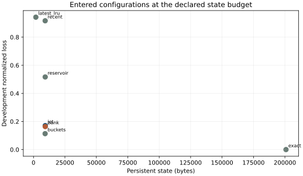
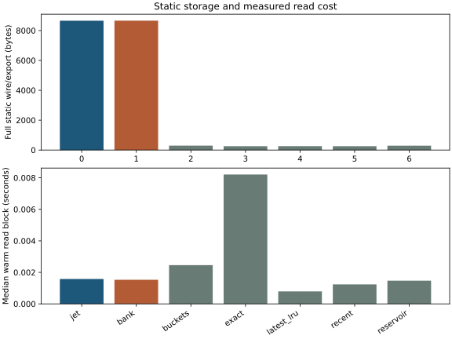
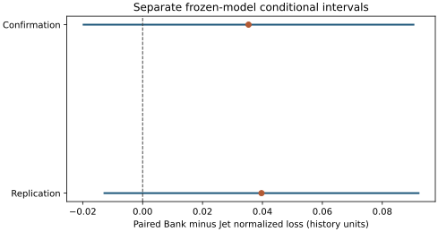

# Run06 report recovery

**Status:** sealed scientific run completed; initial report failed; audited report-only recovery completed.

Execution executable SHA-256: `b994b3ef7b770fb50db7adba3a9125f75c7c5dc1a4cd3dc3d85843d3177e1260`.  
Reporter executable SHA-256: `1bd8aca2d561f7412995c87dd183f908918c5f0ad0aef2006c75f3362f3c0703`.  
Migration manifest SHA-256: `881cf66a7a5b099e5620ab4e4d17699b1c1c005052e67dabb649ec1642b00e27`.  
Recovery launcher SHA-256: `9bcb1724fd16793314f5fcd5f8faef87d78fccfc70343705540ff92f206eb83e`.  
Original exit: 1; report failed: `protected run ID inventory differs from freeze`.

The reproduction commands below describe fresh runs under the corrected reporter; this historical run requires the registered recovery launcher.

# FAM-Jet final artifact report

**Decision:** `jet_advantage_not_demonstrated`.

This comparison estimates Bank minus Jet normalized loss conditional on the frozen fitted readers. The interval excludes retraining variance.

## Reproduce

```sh
.venv/bin/python -m famjet_poc run --out artifacts/poc-core
.venv/bin/python -m famjet_poc run --out artifacts/poc-core --resume
.venv/bin/python -m famjet_poc report --run artifacts/poc-core --out reports/final.md
```

Frozen executable SHA-256: `b994b3ef7b770fb50db7adba3a9125f75c7c5dc1a4cd3dc3d85843d3177e1260`.  
Frozen source SHA-256: `f78761891876540011e577293e31a89c7661ef66adbb522d2cbcd36c331d8475`.  
Release SHA-256: `8b1ed1eec3c3899a4a2d5d8efb38329dbc33545ed88b5ca76e04ddf8dcb9b635`.  
Git revision: `f886e3c41517fd935a642cb83233dd72faf083b0`.

## Admission and calibration

The eight fixed-feature qualification cases established correctness and learnability for four explicit templates at alpha_max=1 and ridge=1e-10; they do not establish arbitrary-window sufficiency or every selected ridge configuration.

Reader qualification: `reused_accepted` (22 archived files).

Calibration attempt 1 failed; independent attempt 2 passed all 32 simultaneous guards. The current conditional-history inference uses the accepted attempt 2; the old crossed bootstrap failure remains unchanged.

Attempt 2 evidence SHA-256: `db4a41b3362fdb6b27f2d9c3c6ba6f5859ffb88543aace1ae3252da4a22921a3`; 256 histories per stratum in each scientific panel.

## Selected readers and development

### K16/V8

Frozen chosen configurations:

| Family | Full configuration SHA | Reader parameters | Development loss | Active numeric B | Full wire static B |
| --- | --- | --- | ---: | ---: | ---: |
| jet | `78d5f023a56f7eb040976507012ae80a9edbed16bfeeb8da26a43a6321c467f0` | `{"alpha_max":0.5,"alpha_min":0.00019142419601837673,"epsilon":1e-06,"family":"jet","query_width":16,"ridge":1e-06,"support_floor":1e-12,"version":"ridge_v1"}` | 0.17049 | 5e+03 | 9e+03 |
| bank | `7c376215b895ef13d2c4fc65f92ac24de94b20c855ed4c4efaf6dfdeb520f428` | `{"alpha_max":2.0,"alpha_min":0.00019142419601837673,"epsilon":1e-06,"family":"bank","query_width":16,"ridge":1e-10,"support_floor":1e-12,"version":"ridge_v1"}` | 0.16383 | 5e+03 | 9e+03 |

Complete candidate ledger:

| Family | Candidate | Development loss | Full wire static B | Fit wall s | Total standalone s | Status / failure |
| --- | --- | ---: | ---: | ---: | ---: | --- |
| jet | `e2dfaebb3c24` | 0.29509 | 6e+03 | 18.104 | 87.763 | qualified |
| jet | `e3c747d473ff` | 0.33682 | 6e+03 | 18.503 | 88.385 | qualified |
| jet | `ce823446343b` | 0.29241 | 6e+03 | 18.801 | 89.053 | qualified |
| jet | `e9666b360551` | 0.2896 | 6e+03 | 18.934 | 89.18 | qualified |
| jet | `ef86c50f7f45` | 0.33242 | 6e+03 | 19.096 | 89.567 | qualified |
| jet | `e630c8f0bd18` | 0.28585 | 6e+03 | 19.117 | 89.64 | qualified |
| jet | `74b27ae4e657` | 0.2299 | 6e+03 | 19.176 | 89.832 | qualified |
| jet | `b7ceca452f30` | 0.23192 | 6e+03 | 19.302 | 89.964 | qualified |
| jet | `900fa15209ab` | 0.23184 | 6e+03 | 19.365 | 90.214 | qualified |
| jet | `915f417304e9` | 0.17802 | 9e+03 | 19.565 | 90.438 | qualified |
| jet | `07ef3ee8c915` | 0.18269 | 9e+03 | 19.597 | 90.455 | qualified |
| jet | `dc32379ab33e` | 0.18379 | 9e+03 | 19.635 | 90.449 | qualified |
| jet | `78d5f023a56f` | 0.17049 | 9e+03 | 19.697 | 90.539 | qualified |
| jet | `67a9ae98d751` | 0.19 | 9e+03 | 19.709 | 90.582 | qualified |
| jet | `4ae003c4b421` | 0.17662 | 9e+03 | 19.787 | 90.752 | qualified |
| jet | `872e4b78d9b9` | 0.19136 | 9e+03 | 19.789 | 90.758 | qualified |
| jet | `740f52f3cbab` | 0.19255 | 9e+03 | 19.845 | 90.884 | qualified |
| jet | `691d7052f367` | 0.19489 | 9e+03 | 19.892 | 90.902 | qualified |
| bank | `9c280db79c79` | 0.25852 | 6e+03 | 19.637 | 89.938 | qualified |
| bank | `48d6ca66681c` | 0.26446 | 6e+03 | 19.761 | 90.165 | qualified |
| bank | `2b427adf908e` | 0.26226 | 6e+03 | 19.744 | 90.085 | qualified |
| bank | `f8cd732d9ef2` | 0.25413 | 6e+03 | 19.858 | 90.284 | qualified |
| bank | `cb900587d201` | 0.25968 | 6e+03 | 19.851 | 90.312 | qualified |
| bank | `3f94a798749b` | 0.25951 | 6e+03 | 19.817 | 90.266 | qualified |
| bank | `dba0e633d10e` | 0.23522 | 6e+03 | 19.848 | 90.313 | qualified |
| bank | `aa7315c159db` | 0.23608 | 6e+03 | 19.947 | 90.469 | qualified |
| bank | `f7277008b72b` | 0.23434 | 6e+03 | 19.956 | 90.433 | qualified |
| bank | `e0f924691ac4` | 0.20103 | 9e+03 | 20.103 | 90.624 | qualified |
| bank | `d75d8dd704ef` | 0.18206 | 9e+03 | 20.096 | 90.592 | qualified |
| bank | `7c376215b895` | 0.16383 | 9e+03 | 20.146 | 90.633 | qualified |
| bank | `9759bc22c17c` | 0.17611 | 9e+03 | 20.096 | 90.806 | qualified |
| bank | `d1f07b5ba8ee` | 0.17335 | 9e+03 | 20.155 | 90.72 | qualified |
| bank | `2d6bd8dfe237` | 0.17088 | 9e+03 | 20.163 | 90.722 | qualified |
| bank | `d79dd464cf4c` | 0.20001 | 9e+03 | 20.118 | 90.767 | qualified |
| bank | `d048f79db8bf` | 0.20103 | 9e+03 | 20.273 | 90.833 | qualified |
| bank | `b08ba202810a` | 0.19992 | 9e+03 | 20.15 | 90.771 | qualified |

Subset fits (each has training-only statistics):

| Family | Training histories | Loss | Evaluation s | Status / failure |
| --- | ---: | ---: | ---: | --- |
| jet | 192 | 0.51164 | 17.071 | measured |
| jet | 384 | 0.41201 | 17.07 | measured |
| bank | 192 | 0.93481 | 16.244 | measured |
| bank | 384 | 0.48488 | 16.244 | measured |

Training/development cache bytes: 154124241/38543884; fit attempts/completions: 40/40.

Simple controls:

| Control | Loss | Occupied state B | Full static B | Evaluation s |
| --- | ---: | ---: | ---: | ---: |
| buckets | 0.11344 | 9e+03 | 3e+02 | 67.374 |
| exact | 0 | 2e+05 | 3e+02 | 23.727 |
| laguerre | 0.17049 | 9e+03 | 9e+03 | 67.106 |
| latest_lru | 0.94214 | 2e+03 | 3e+02 | 13.658 |
| recent | 0.91645 | 9e+03 | 3e+02 | 13.777 |
| reservoir | 0.51674 | 9e+03 | 3e+02 | 14.109 |

### K12/V1

Frozen chosen configurations:

| Family | Full configuration SHA | Reader parameters | Development loss | Active numeric B | Full wire static B |
| --- | --- | --- | ---: | ---: | ---: |
| jet | `872e4b78d9b994ae7c75f7dd0b3c8079946b15f2f9cd5144e8286392b9495f34` | `{"alpha_max":0.5,"alpha_min":0.00019142419601837673,"epsilon":1e-06,"family":"jet","query_width":16,"ridge":0.01,"support_floor":1e-12,"version":"ridge_v1"}` | 0.35904 | 5e+03 | 8e+03 |
| bank | `9759bc22c17c9f0ddf5e034dc426c6d18c3c5b2ad6a44ab75deedd8ca41f45ae` | `{"alpha_max":0.5,"alpha_min":0.00019142419601837673,"epsilon":1e-06,"family":"bank","query_width":16,"ridge":1e-06,"support_floor":1e-12,"version":"ridge_v1"}` | 0.36399 | 5e+03 | 8e+03 |

Complete candidate ledger:

| Family | Candidate | Development loss | Full wire static B | Fit wall s | Total standalone s | Status / failure |
| --- | --- | ---: | ---: | ---: | ---: | --- |
| jet | `e2dfaebb3c24` | 0.51509 | 5e+03 | 15.339 | 82.462 | qualified |
| jet | `e3c747d473ff` | 0.50136 | 5e+03 | 15.482 | 82.725 | qualified |
| jet | `ce823446343b` | 0.58292 | 5e+03 | 15.442 | 82.691 | qualified |
| jet | `e9666b360551` | 0.48749 | 5e+03 | 15.523 | 82.889 | qualified |
| jet | `ef86c50f7f45` | 0.47381 | 5e+03 | 15.544 | 82.898 | qualified |
| jet | `e630c8f0bd18` | 0.56814 | 5e+03 | 15.613 | 82.935 | qualified |
| jet | `74b27ae4e657` | 0.5093 | 5e+03 | 15.687 | 83.114 | qualified |
| jet | `b7ceca452f30` | 0.52249 | 5e+03 | 15.684 | 83.092 | qualified |
| jet | `900fa15209ab` | 0.57355 | 5e+03 | 15.732 | 83.164 | qualified |
| jet | `915f417304e9` | 0.48995 | 8e+03 | 15.787 | 83.352 | qualified |
| jet | `07ef3ee8c915` | 0.52065 | 8e+03 | 15.868 | 83.382 | qualified |
| jet | `dc32379ab33e` | 0.50487 | 8e+03 | 15.816 | 83.448 | qualified |
| jet | `78d5f023a56f` | 0.43546 | 8e+03 | 15.844 | 83.474 | qualified |
| jet | `67a9ae98d751` | 0.4593 | 8e+03 | 15.869 | 83.437 | qualified |
| jet | `4ae003c4b421` | 0.44712 | 8e+03 | 15.896 | 83.476 | qualified |
| jet | `872e4b78d9b9` | 0.35904 | 8e+03 | 15.879 | 83.506 | qualified |
| jet | `740f52f3cbab` | 0.38342 | 8e+03 | 15.901 | 83.616 | qualified |
| jet | `691d7052f367` | 0.44322 | 8e+03 | 15.942 | 83.573 | qualified |
| bank | `9c280db79c79` | 0.52156 | 5e+03 | 15.784 | 82.73 | qualified |
| bank | `48d6ca66681c` | 0.53142 | 5e+03 | 15.861 | 82.818 | qualified |
| bank | `2b427adf908e` | 0.60179 | 5e+03 | 15.845 | 82.832 | qualified |
| bank | `f8cd732d9ef2` | 0.47531 | 5e+03 | 15.826 | 82.816 | qualified |
| bank | `cb900587d201` | 0.48564 | 5e+03 | 15.904 | 82.977 | qualified |
| bank | `3f94a798749b` | 0.56324 | 5e+03 | 15.955 | 83.014 | qualified |
| bank | `dba0e633d10e` | 0.52882 | 5e+03 | 15.966 | 82.954 | qualified |
| bank | `aa7315c159db` | 0.54012 | 5e+03 | 15.99 | 83.082 | qualified |
| bank | `f7277008b72b` | 0.58598 | 5e+03 | 16.085 | 83.159 | qualified |
| bank | `e0f924691ac4` | 0.4642 | 8e+03 | 16.039 | 83.273 | qualified |
| bank | `d75d8dd704ef` | 0.48655 | 8e+03 | 16.002 | 83.147 | qualified |
| bank | `7c376215b895` | 0.59302 | 8e+03 | 16.076 | 83.28 | qualified |
| bank | `9759bc22c17c` | 0.36399 | 8e+03 | 16.064 | 83.212 | qualified |
| bank | `d1f07b5ba8ee` | 0.37774 | 8e+03 | 16.051 | 83.235 | qualified |
| bank | `2d6bd8dfe237` | 0.47138 | 8e+03 | 16.073 | 83.188 | qualified |
| bank | `d79dd464cf4c` | 0.39099 | 8e+03 | 16.147 | 83.373 | qualified |
| bank | `d048f79db8bf` | 0.39982 | 8e+03 | 16.084 | 83.307 | qualified |
| bank | `b08ba202810a` | 0.44755 | 8e+03 | 16.178 | 83.456 | qualified |

Subset fits (each has training-only statistics):

| Family | Training histories | Loss | Evaluation s | Status / failure |
| --- | ---: | ---: | ---: | --- |
| jet | 192 | 0.43472 | 17.067 | measured |
| jet | 384 | 0.4181 | 16.989 | measured |
| bank | 192 | 1.0032 | 16.065 | measured |
| bank | 384 | 0.44421 | 16.118 | measured |

Training/development cache bytes: 79084653/19780906; fit attempts/completions: 40/40.

Simple controls:

| Control | Loss | Occupied state B | Full static B | Evaluation s |
| --- | ---: | ---: | ---: | ---: |
| buckets | 0.69835 | 2e+03 | 3e+02 | 37.35 |
| exact | 0 | 7e+04 | 3e+02 | 22.137 |
| laguerre | 0.35904 | 2e+03 | 8e+03 | 68.102 |
| latest_lru | 1.8906 | 7e+02 | 3e+02 | 13.976 |
| recent | 1.8953 | 2e+03 | 3e+02 | 13.484 |
| reservoir | 1.4667 | 2e+03 | 3e+02 | 13.776 |

## One-budget accuracy, state, static storage and cost

The charts contain the seven deployment-timed methods at the one declared persistent-state budget. Gamma/Laguerre is omitted from these charts: deployment latency is `not_measured` (machine value `null`). Its scored accuracy, state, coordinate diagnostics and reference-validation costs remain in the tables and machine JSON. Full wire-export static bytes are separate from active numeric parameters and recurrent state; cache construction, fit, preprocessing, serialization, cold start and isolated worker costs remain in the machine JSON and timing receipts.





| Method | Q1 read p50 s | Q8 read p50 s | Q64 read p50 s | Q8 preprocess p50 s | Q8 serialization p50 s |
| --- | ---: | ---: | ---: | ---: | ---: |
| bank | 0.00048775 | 0.0015282 | 0.0095276 | 0.0020423 | 0.0042534 |
| buckets | 0.0011906 | 0.0024567 | 0.01157 | 0.0020477 | 0.0040938 |
| exact | 0.0022413 | 0.0082074 | 0.015694 | 0.0020624 | 0.0055171 |
| jet | 0.00049798 | 0.0015771 | 0.0096726 | 0.002063 | 0.0042158 |
| latest_lru | 0.00039219 | 0.00079171 | 0.0035989 | 0.0020565 | 0.0038468 |
| recent | 0.00068825 | 0.0012382 | 0.0053514 | 0.0030907 | 0.0039218 |
| reservoir | 0.00073906 | 0.0014712 | 0.0067529 | 0.0022095 | 0.0039605 |

## Protected confirmation and independent replication

| Panel | Paired histories | Bank − Jet | 95% lower | 95% upper | Superiority |
| --- | ---: | ---: | ---: | ---: | --- |
| confirmation | 3072 | 0.035354 | -0.019711 | 0.090419 | False |
| replication | 3072 | 0.039683 | -0.012748 | 0.092114 | False |



The nuisance pilot was separate and could not select the effect direction. All entered methods and all raw rows, including fallback and ineligible diagnostics, remain in the release.

| Panel / method | Raw rows | Eligible primary | Ineligible | Fallbacks | Mean normalized loss |
| --- | ---: | ---: | ---: | ---: | ---: |
| pilot/bank | 1536 | 1536 | 0 | 0 | 0.19878 |
| pilot/jet | 1536 | 1536 | 0 | 0 | 0.24345 |
| pilot/exact | 1536 | 1536 | 0 | 0 | 0 |
| pilot/recent | 1536 | 1536 | 0 | 1053 | 1.0376 |
| pilot/latest_lru | 1536 | 1536 | 0 | 1493 | 1.0619 |
| pilot/reservoir | 1536 | 1536 | 0 | 771 | 0.63942 |
| pilot/buckets | 1536 | 1536 | 0 | 0 | 0.13171 |
| pilot/laguerre | 1536 | 1536 | 0 | 0 | 0.24345 |
| confirmation/bank | 24576 | 24576 | 0 | 0 | 0.19184 |
| confirmation/jet | 24576 | 24576 | 0 | 0 | 0.15649 |
| confirmation/exact | 24576 | 24576 | 0 | 0 | 0 |
| confirmation/recent | 24576 | 24576 | 0 | 16750 | 0.90669 |
| confirmation/latest_lru | 24576 | 24576 | 0 | 23770 | 0.96292 |
| confirmation/reservoir | 24576 | 24576 | 0 | 12172 | 0.5535 |
| confirmation/buckets | 24576 | 24576 | 0 | 0 | 0.12862 |
| confirmation/laguerre | 24576 | 24576 | 0 | 0 | 0.15649 |
| replication/bank | 24576 | 24576 | 0 | 0 | 0.20607 |
| replication/jet | 24576 | 24576 | 0 | 0 | 0.16638 |
| replication/exact | 24576 | 24576 | 0 | 0 | 0 |
| replication/recent | 24576 | 24576 | 0 | 16786 | 0.88073 |
| replication/latest_lru | 24576 | 24576 | 0 | 23789 | 0.95692 |
| replication/reservoir | 24576 | 24576 | 0 | 12294 | 0.54212 |
| replication/buckets | 24576 | 24576 | 0 | 0 | 0.14074 |
| replication/laguerre | 24576 | 24576 | 0 | 0 | 0.16638 |

## Beijing 2015–17 transfer

Both K12/V1 modes use the frozen training normalization and the same 56 chronological test blocks with 120 queries per block. Native contrast inversion scales without adding the pollutant mean.

| Mode | Method | Native RMSE µg/m³ | Native MAE µg/m³ | Normalized loss | Eligible / ineligible | Fallbacks |
| --- | --- | ---: | ---: | ---: | ---: | ---: |
| synthetic_frozen | jet | 130.49 | 99.528 | 5.0164 | 6693 / 27 | 0 |
| synthetic_frozen | bank | 1069.5 | 621.09 | 321.35 | 6693 / 27 | 0 |
| synthetic_frozen | exact | 0 | 0 | 0 | 6693 / 27 | 27 |
| synthetic_frozen | recent | 53.868 | 30.323 | 0.88366 | 6693 / 27 | 2723 |
| synthetic_frozen | latest_lru | 57.302 | 33.192 | 0.98175 | 6693 / 27 | 3371 |
| synthetic_frozen | reservoir | 62.856 | 43.197 | 1.1776 | 6693 / 27 | 5050 |
| synthetic_frozen | buckets | 55.229 | 34.513 | 0.90479 | 6693 / 27 | 24 |
| synthetic_frozen | laguerre | 130.49 | 99.528 | 5.0164 | 6693 / 27 | 0 |
| task_adapted | jet | 68.642 | 15.354 | 1.4784 | 6693 / 27 | 0 |
| task_adapted | bank | 21.36 | 12.705 | 0.14705 | 6693 / 27 | 0 |
| task_adapted | exact | 0 | 0 | 0 | 6693 / 27 | 27 |
| task_adapted | recent | 53.868 | 30.323 | 0.88366 | 6693 / 27 | 2723 |
| task_adapted | latest_lru | 57.302 | 33.192 | 0.98175 | 6693 / 27 | 3371 |
| task_adapted | reservoir | 62.856 | 43.197 | 1.1776 | 6693 / 27 | 5050 |
| task_adapted | buckets | 55.229 | 34.513 | 0.90479 | 6693 / 27 | 24 |
| task_adapted | laguerre | 68.642 | 15.354 | 1.4784 | 6693 / 27 | 0 |

The 28-day and 56-day cluster sensitivities use 28 and 14 units respectively. They describe this finite period and do not provide future-period population significance.

| Mode | Cluster | Paired Bank − Jet resampled 95% range | Units |
| --- | --- | --- | ---: |
| synthetic_frozen | 28d | 145.21 to 551.08 | 28 |
| synthetic_frozen | 56d | 135.04 to 546.93 | 14 |
| task_adapted | 28d | -3.021 to -0.23743 | 28 |
| task_adapted | 56d | -2.6748 to -0.28031 | 14 |

### Task-adapted public fit costs

Measured prefreeze probe: 0.2624 s fit, 0.90306 s read; forecast 379.8 s.
Real training/development cache: 19491409 B; prefreeze elapsed: 335.63 s. The selected equivalent reference has separate cost and scored-row receipts.

| Family | Candidate | Public development loss | Active numeric B | Evaluation s | Status |
| --- | --- | ---: | ---: | ---: | --- |
| jet | `e2dfaebb3c24` | 0.7563 | 3e+03 | 1.7721 | qualified |
| jet | `e3c747d473ff` | 0.77241 | 3e+03 | 1.7717 | qualified |
| jet | `ce823446343b` | 0.77477 | 3e+03 | 1.8103 | qualified |
| jet | `e9666b360551` | 0.75512 | 3e+03 | 1.7806 | qualified |
| jet | `ef86c50f7f45` | 0.77592 | 3e+03 | 1.7884 | qualified |
| jet | `e630c8f0bd18` | 0.83974 | 3e+03 | 1.7687 | qualified |
| jet | `74b27ae4e657` | 0.8722 | 3e+03 | 1.7665 | qualified |
| jet | `b7ceca452f30` | 0.87308 | 3e+03 | 1.7614 | qualified |
| jet | `900fa15209ab` | 0.92562 | 3e+03 | 1.7668 | qualified |
| jet | `915f417304e9` | 0.27848 | 5e+03 | 1.7914 | qualified |
| jet | `07ef3ee8c915` | 0.24981 | 5e+03 | 1.7884 | qualified |
| jet | `dc32379ab33e` | 0.33417 | 5e+03 | 1.803 | qualified |
| jet | `78d5f023a56f` | 0.37726 | 5e+03 | 1.7831 | qualified |
| jet | `67a9ae98d751` | 0.29675 | 5e+03 | 1.8224 | qualified |
| jet | `4ae003c4b421` | 0.46609 | 5e+03 | 1.791 | qualified |
| jet | `872e4b78d9b9` | 0.60409 | 5e+03 | 1.7763 | qualified |
| jet | `740f52f3cbab` | 0.58948 | 5e+03 | 1.7752 | qualified |
| jet | `691d7052f367` | 0.65358 | 5e+03 | 1.776 | qualified |
| bank | `9c280db79c79` | 0.75838 | 3e+03 | 1.6938 | qualified |
| bank | `48d6ca66681c` | 0.75498 | 3e+03 | 1.6794 | qualified |
| bank | `2b427adf908e` | 0.80078 | 3e+03 | 1.7179 | qualified |
| bank | `f8cd732d9ef2` | 0.8002 | 3e+03 | 1.6792 | qualified |
| bank | `cb900587d201` | 0.7637 | 3e+03 | 1.6879 | qualified |
| bank | `3f94a798749b` | 0.84504 | 3e+03 | 1.6976 | qualified |
| bank | `dba0e633d10e` | 0.87762 | 3e+03 | 1.6641 | qualified |
| bank | `aa7315c159db` | 0.87816 | 3e+03 | 1.6949 | qualified |
| bank | `f7277008b72b` | 0.86638 | 3e+03 | 1.6625 | qualified |
| bank | `e0f924691ac4` | 0.27745 | 5e+03 | 1.6844 | qualified |
| bank | `d75d8dd704ef` | 0.21611 | 5e+03 | 1.7067 | qualified |
| bank | `7c376215b895` | 0.30931 | 5e+03 | 1.717 | qualified |
| bank | `9759bc22c17c` | 0.36307 | 5e+03 | 1.6905 | qualified |
| bank | `d1f07b5ba8ee` | 0.30276 | 5e+03 | 1.7024 | qualified |
| bank | `2d6bd8dfe237` | 0.38479 | 5e+03 | 1.6993 | qualified |
| bank | `d79dd464cf4c` | 0.60742 | 5e+03 | 1.6915 | qualified |
| bank | `d048f79db8bf` | 0.60078 | 5e+03 | 1.7428 | qualified |
| bank | `b08ba202810a` | 0.58884 | 5e+03 | 1.7131 | qualified |

## Secondary tasks and robustness

| Cell | Shape | Status | Reason |
| --- | --- | --- | --- |
| latest | K16/V8 | unsupported | No qualified latest-task fitting/output/scoring bridge |
| presence | K16/V8 | unsupported | No qualified binary output/scoring bridge |
| interval_support | K16/V8 | unsupported | No calibrated support logit or qualified output bridge |
| change_sign | K16/V8 | unsupported | No qualified change-sign output/scoring bridge |
| corrected_categorical_v32 | K16/V32 | unsupported | No V32 checkpoint or qualified categorical reader |
| random_binding_v32 | K16/V32 | unsupported | No V32 checkpoint or qualified categorical reader |
| sharp_windows | K16/V8 | implemented/scored | — |
| standard | K16/V8 | implemented/scored | — |
| zipf | K16/V8 | implemented/scored | — |
| lognormal_gaps | K16/V8 | implemented/scored | — |
| heavy_gaps | K16/V8 | implemented/scored | — |
| heavy_noise | K16/V8 | implemented/scored | — |
| fast_resets | K16/V8 | implemented/scored | — |
| broad_periods | K16/V8 | implemented/scored | — |
| unseen_reversals | K16/V8 | implemented/scored | — |

Entered robustness and boundary outcomes:

| Mode | Method | Status | Normalized loss | Fallbacks | Evaluation s |
| --- | --- | --- | ---: | ---: | ---: |
| standard | bank | ok | 0.043655 | 0 | 1.106 |
| standard | jet | ok | 0.042065 | 0 | 1.1131 |
| standard | exact | ok | 0 | 0 | 1.2137 |
| standard | recent | ok | 0.39139 | 1e+02 | 0.97647 |
| standard | latest_lru | ok | 0.3965 | 1e+02 | 0.95804 |
| standard | reservoir | ok | 0.14822 | 7e+01 | 0.98916 |
| standard | buckets | ok | 0.026165 | 0 | 3.4156 |
| standard | laguerre | ok | 0.042065 | 0 | 3.504 |
| zipf | bank | ok | 0.29617 | 0 | 1.0871 |
| zipf | jet | ok | 0.063324 | 0 | 1.1541 |
| zipf | exact | ok | 0 | 0 | 1.2367 |
| zipf | recent | ok | 0.21502 | 1e+02 | 0.96869 |
| zipf | latest_lru | ok | 0.25143 | 1e+02 | 0.95132 |
| zipf | reservoir | ok | 0.16644 | 8e+01 | 1.0273 |
| zipf | buckets | ok | 0.032174 | 0 | 3.4047 |
| zipf | laguerre | ok | 0.063324 | 0 | 3.5323 |
| lognormal_gaps | bank | ok | 0.056082 | 0 | 1.1036 |
| lognormal_gaps | jet | ok | 0.050333 | 0 | 1.1418 |
| lognormal_gaps | exact | ok | 0 | 0 | 1.2506 |
| lognormal_gaps | recent | ok | 0.21908 | 1e+02 | 0.98321 |
| lognormal_gaps | latest_lru | ok | 0.25075 | 1e+02 | 0.96811 |
| lognormal_gaps | reservoir | ok | 0.084511 | 8e+01 | 1.0051 |
| lognormal_gaps | buckets | ok | 0.025978 | 0 | 3.5919 |
| lognormal_gaps | laguerre | ok | 0.050333 | 0 | 3.5435 |
| heavy_gaps | bank | ok | 0.080438 | 0 | 1.1067 |
| heavy_gaps | jet | ok | 0.063388 | 0 | 1.1431 |
| heavy_gaps | exact | ok | 0 | 0 | 1.2584 |
| heavy_gaps | recent | ok | 0.30113 | 1e+02 | 0.9911 |
| heavy_gaps | latest_lru | ok | 0.40908 | 1e+02 | 0.97645 |
| heavy_gaps | reservoir | ok | 0.36507 | 8e+01 | 1.0003 |
| heavy_gaps | buckets | ok | 0.044242 | 0 | 3.5744 |
| heavy_gaps | laguerre | ok | 0.063388 | 0 | 3.557 |
| heavy_noise | bank | ok | 0.04328 | 0 | 1.1066 |
| heavy_noise | jet | ok | 0.03715 | 0 | 1.1399 |
| heavy_noise | exact | ok | 0 | 0 | 1.2284 |
| heavy_noise | recent | ok | 0.15664 | 1e+02 | 0.98713 |
| heavy_noise | latest_lru | ok | 0.2088 | 1e+02 | 0.96802 |
| heavy_noise | reservoir | ok | 0.13901 | 7e+01 | 0.99674 |
| heavy_noise | buckets | ok | 0.023263 | 0 | 3.3881 |
| heavy_noise | laguerre | ok | 0.03715 | 0 | 3.5718 |
| fast_resets | bank | ok | 0.067107 | 0 | 1.1148 |
| fast_resets | jet | ok | 0.074469 | 0 | 1.1535 |
| fast_resets | exact | ok | 0 | 0 | 1.2139 |
| fast_resets | recent | ok | 0.20362 | 1e+02 | 0.99215 |
| fast_resets | latest_lru | ok | 0.24404 | 1e+02 | 0.97057 |
| fast_resets | reservoir | ok | 0.15123 | 7e+01 | 1.0082 |
| fast_resets | buckets | ok | 0.035988 | 0 | 3.4004 |
| fast_resets | laguerre | ok | 0.074469 | 0 | 3.5568 |
| broad_periods | bank | ok | 0.043554 | 0 | 1.1102 |
| broad_periods | jet | ok | 0.050008 | 0 | 1.165 |
| broad_periods | exact | ok | 0 | 0 | 1.2367 |
| broad_periods | recent | ok | 0.18113 | 1e+02 | 0.99628 |
| broad_periods | latest_lru | ok | 0.23783 | 1e+02 | 0.96461 |
| broad_periods | reservoir | ok | 0.11891 | 7e+01 | 1.0152 |
| broad_periods | buckets | ok | 0.057319 | 0 | 3.3774 |
| broad_periods | laguerre | ok | 0.050008 | 0 | 3.5446 |
| unseen_reversals | bank | ok | 0.04465 | 0 | 1.1006 |
| unseen_reversals | jet | ok | 0.040717 | 0 | 1.1557 |
| unseen_reversals | exact | ok | 0 | 0 | 1.2219 |
| unseen_reversals | recent | ok | 0.17463 | 1e+02 | 0.98596 |
| unseen_reversals | latest_lru | ok | 0.19769 | 1e+02 | 0.97158 |
| unseen_reversals | reservoir | ok | 0.14594 | 8e+01 | 1.0154 |
| unseen_reversals | buckets | ok | 0.028702 | 0 | 3.4092 |
| unseen_reversals | laguerre | ok | 0.040717 | 0 | 3.6038 |
| boundary | bank | ok | 1.9863 | 0 | 1.1023 |
| boundary | jet | ok | 0.32509 | 0 | 1.133 |
| boundary | exact | ok | 0 | 0 | 1.2024 |
| boundary | recent | ok | 0.23565 | 6e+01 | 0.96337 |
| boundary | latest_lru | ok | 0.23872 | 6e+01 | 0.97377 |
| boundary | reservoir | ok | 0.18007 | 6e+01 | 0.98292 |
| boundary | buckets | ok | 0.0075049 | 0 | 3.3818 |
| boundary | laguerre | ok | 0.32509 | 0 | 3.5567 |

Unsupported cells have null metrics in the machine JSON. Numeric mean/contrast results do not imply V32 categorical or support-logit capabilities.

## Provenance, failures and limits

The complete source/model/grant/score-policy/full-versus-eligible inventory/row/cost checks precede this report. Raw data, query failures, ineligible labels and training-prior fallbacks remain in the sealed per-query artifacts.

Beijing v2 source manifest SHA-256: `5bf4ead56d916538944ed7c3145e2800d281f567c19c1bc204233044d832d21c`. Official archive SHA-256: `b04da438b2f331ac0ffd45aebdfec0d20d2367feb5f6948c4b1f7ce1191e33c4`; license: CC BY 4.0; revision: beijing_observed_v2_targets. Full per-split prepared-array hashes, source attribution and original archive identity are retained in the machine JSON. External prepared arrays have status `verified_inventory_not_rehashed`: copied-run analysis checks their sealed hash inventory and evaluated row/count/grant receipts without reopening the source array bytes.

The six earlier MLP qualification failures, extreme signed-cancellation numerical failures, and old crossed-bootstrap failure remain failed. The new qualified reader and conditional inference do not repair them.

No multi-budget memory frontier, broad information-capacity result, agent result, all-family superiority or novelty claim follows from this one entered study.

## Coordinate numerical diagnostics

Gamma/Laguerre is a numerical control. Strict FP64 read equivalence is not established where the original 1e-12 absolute/relative criterion FAILED. State and all five mask checks remain mandatory; prediction-only rounding is recorded, without a wider tolerance.

| Receipt scope | Histories | Queries | Failed histories / queries / scalars | Strict read | State / masks | Max state abs / scaled | Max read abs / scaled |
| --- | ---: | ---: | --- | --- | --- | --- | --- |
| development/K16/V8/controls/laguerre/costs | 192 | 1536 | 16 / 21 / 82 | FAILED | PASSED / PASSED | 9.5497e-12 / 0.10606 | 2.3931e-11 / 15.208 |
| development/K12/V1/controls/laguerre/costs | 192 | 1536 | 8 / 8 / 8 | FAILED | PASSED / PASSED | 8.5265e-12 / 0.04302 | 3.6586e-12 / 3.5704 |
| synthetic/by_phase_method/pilot/laguerre/costs/0 | 16 | 128 | 2 / 3 / 17 | FAILED | PASSED / PASSED | 2.0206e-14 / 0.012052 | 2.0586e-11 / 12.311 |
| synthetic/by_phase_method/pilot/laguerre/costs/1 | 16 | 128 | 2 / 3 / 15 | FAILED | PASSED / PASSED | 2.5757e-14 / 0.011404 | 1.4282e-11 / 5.1241 |
| synthetic/by_phase_method/pilot/laguerre/costs/2 | 16 | 128 | 2 / 2 / 6 | FAILED | PASSED / PASSED | 1.4988e-14 / 0.0089058 | 2.1902e-12 / 1.9824 |
| synthetic/by_phase_method/pilot/laguerre/costs/3 | 16 | 128 | 1 / 1 / 4 | FAILED | PASSED / PASSED | 1.6542e-14 / 0.0097842 | 2.5515e-12 / 2.4435 |
| synthetic/by_phase_method/pilot/laguerre/costs/4 | 16 | 128 | 0 / 0 / 0 | PASSED | PASSED / PASSED | 1.0036e-13 / 0.0147 | 5.3957e-14 / 0.04473 |
| synthetic/by_phase_method/pilot/laguerre/costs/5 | 16 | 128 | 2 / 2 / 9 | FAILED | PASSED / PASSED | 5.6843e-13 / 0.017298 | 2.2553e-11 / 7.0826 |
| synthetic/by_phase_method/pilot/laguerre/costs/6 | 16 | 128 | 2 / 2 / 5 | FAILED | PASSED / PASSED | 8.5265e-14 / 0.012388 | 4.6247e-12 / 3.1844 |
| synthetic/by_phase_method/pilot/laguerre/costs/7 | 16 | 128 | 3 / 3 / 7 | FAILED | PASSED / PASSED | 9.0594e-14 / 0.018966 | 4.3312e-12 / 2.4402 |
| synthetic/by_phase_method/pilot/laguerre/costs/8 | 16 | 128 | 1 / 2 / 6 | FAILED | PASSED / PASSED | 3.5527e-13 / 0.041203 | 5.4641e-12 / 2.6731 |
| synthetic/by_phase_method/pilot/laguerre/costs/9 | 16 | 128 | 3 / 3 / 8 | FAILED | PASSED / PASSED | 7.9581e-12 / 0.095853 | 5.3262e-11 / 6.1023 |
| synthetic/by_phase_method/pilot/laguerre/costs/10 | 16 | 128 | 1 / 1 / 1 | FAILED | PASSED / PASSED | 5.9686e-13 / 0.0089771 | 2.8564e-12 / 1.0685 |
| synthetic/by_phase_method/pilot/laguerre/costs/11 | 16 | 128 | 1 / 1 / 1 | FAILED | PASSED / PASSED | 3.1974e-13 / 0.079168 | 1.1076e-12 / 1.0583 |
| synthetic/by_phase_method/confirmation/laguerre/costs/0 | 256 | 2048 | 41 / 56 / 184 | FAILED | PASSED / PASSED | 2.9532e-14 / 0.013144 | 2.6176e-11 / 14.467 |
| synthetic/by_phase_method/confirmation/laguerre/costs/1 | 256 | 2048 | 32 / 45 / 228 | FAILED | PASSED / PASSED | 3.9746e-14 / 0.018967 | 1.0722e-10 / 20.666 |
| synthetic/by_phase_method/confirmation/laguerre/costs/2 | 256 | 2048 | 41 / 55 / 180 | FAILED | PASSED / PASSED | 2.3981e-14 / 0.014937 | 2.9639e-11 / 21.308 |
| synthetic/by_phase_method/confirmation/laguerre/costs/3 | 256 | 2048 | 35 / 45 / 173 | FAILED | PASSED / PASSED | 4.0634e-14 / 0.017258 | 6.8972e-11 / 18.85 |
| synthetic/by_phase_method/confirmation/laguerre/costs/4 | 256 | 2048 | 21 / 21 / 48 | FAILED | PASSED / PASSED | 1.3145e-13 / 0.019531 | 2.0431e-11 / 11.901 |
| synthetic/by_phase_method/confirmation/laguerre/costs/5 | 256 | 2048 | 23 / 27 / 105 | FAILED | PASSED / PASSED | 6.9633e-13 / 0.041909 | 6.4048e-11 / 11.833 |
| synthetic/by_phase_method/confirmation/laguerre/costs/6 | 256 | 2048 | 26 / 29 / 79 | FAILED | PASSED / PASSED | 1.4211e-13 / 0.014496 | 4.127e-11 / 17.03 |
| synthetic/by_phase_method/confirmation/laguerre/costs/7 | 256 | 2048 | 15 / 18 / 59 | FAILED | PASSED / PASSED | 1.2967e-13 / 0.023011 | 2.7303e-11 / 24.963 |
| synthetic/by_phase_method/confirmation/laguerre/costs/8 | 256 | 2048 | 22 / 28 / 45 | FAILED | PASSED / PASSED | 5.0449e-13 / 0.068931 | 1.7232e-11 / 4.1763 |
| synthetic/by_phase_method/confirmation/laguerre/costs/9 | 256 | 2048 | 31 / 34 / 130 | FAILED | PASSED / PASSED | 1.1823e-11 / 0.54412 | 2.1561e-10 / 112.59 |
| synthetic/by_phase_method/confirmation/laguerre/costs/10 | 256 | 2048 | 19 / 22 / 46 | FAILED | PASSED / PASSED | 6.1107e-13 / 0.026665 | 1.4815e-11 / 5.9321 |
| synthetic/by_phase_method/confirmation/laguerre/costs/11 | 256 | 2048 | 11 / 14 / 27 | FAILED | PASSED / PASSED | 5.5422e-13 / 0.11922 | 1.166e-11 / 4.3516 |
| synthetic/by_phase_method/replication/laguerre/costs/0 | 256 | 2048 | 30 / 36 / 131 | FAILED | PASSED / PASSED | 2.3093e-14 / 0.013255 | 1.8142e-11 / 9.9125 |
| synthetic/by_phase_method/replication/laguerre/costs/1 | 256 | 2048 | 40 / 50 / 242 | FAILED | PASSED / PASSED | 3.7081e-14 / 0.019766 | 6.7587e-11 / 23.152 |
| synthetic/by_phase_method/replication/laguerre/costs/2 | 256 | 2048 | 38 / 49 / 162 | FAILED | PASSED / PASSED | 2.5313e-14 / 0.013222 | 2.4592e-11 / 11.329 |
| synthetic/by_phase_method/replication/laguerre/costs/3 | 256 | 2048 | 39 / 51 / 206 | FAILED | PASSED / PASSED | 3.5305e-14 / 0.014948 | 4.1672e-11 / 9.6801 |
| synthetic/by_phase_method/replication/laguerre/costs/4 | 256 | 2048 | 25 / 28 / 59 | FAILED | PASSED / PASSED | 1.2257e-13 / 0.027592 | 1.4282e-11 / 5.3072 |
| synthetic/by_phase_method/replication/laguerre/costs/5 | 256 | 2048 | 32 / 39 / 173 | FAILED | PASSED / PASSED | 7.5318e-13 / 0.02932 | 2.6607e-10 / 18.637 |
| synthetic/by_phase_method/replication/laguerre/costs/6 | 256 | 2048 | 26 / 32 / 97 | FAILED | PASSED / PASSED | 1.2257e-13 / 0.015295 | 2.4851e-11 / 9.4162 |
| synthetic/by_phase_method/replication/laguerre/costs/7 | 256 | 2048 | 27 / 31 / 72 | FAILED | PASSED / PASSED | 1.5454e-13 / 0.023225 | 1.2514e-11 / 11.259 |
| synthetic/by_phase_method/replication/laguerre/costs/8 | 256 | 2048 | 13 / 14 / 25 | FAILED | PASSED / PASSED | 4.4054e-13 / 0.10729 | 7.2777e-12 / 3.8671 |
| synthetic/by_phase_method/replication/laguerre/costs/9 | 256 | 2048 | 29 / 34 / 107 | FAILED | PASSED / PASSED | 1.0459e-11 / 0.53267 | 1.4211e-10 / 40.044 |
| synthetic/by_phase_method/replication/laguerre/costs/10 | 256 | 2048 | 13 / 13 / 40 | FAILED | PASSED / PASSED | 4.9738e-13 / 0.023472 | 2.1024e-11 / 9.7326 |
| synthetic/by_phase_method/replication/laguerre/costs/11 | 256 | 2048 | 22 / 28 / 52 | FAILED | PASSED / PASSED | 6.9633e-13 / 0.10528 | 9.831e-12 / 5.5671 |
| stress/results/7/costs | 16 | 128 | 2 / 3 / 8 | FAILED | PASSED / PASSED | 3.304e-13 / 0.015168 | 1.7354e-11 / 4.4302 |
| stress/results/15/costs | 16 | 128 | 1 / 1 / 6 | FAILED | PASSED / PASSED | 7.3896e-13 / 0.036142 | 7.3875e-11 / 21.694 |
| stress/results/23/costs | 16 | 128 | 2 / 3 / 14 | FAILED | PASSED / PASSED | 2.3803e-13 / 0.020841 | 4.9214e-11 / 10.955 |
| stress/results/31/costs | 16 | 128 | 0 / 0 / 0 | PASSED | PASSED / PASSED | 5.9686e-13 / 0.012678 | 3.0154e-13 / 0.26591 |
| stress/results/39/costs | 16 | 128 | 1 / 1 / 6 | FAILED | PASSED / PASSED | 4.2633e-13 / 0.021582 | 1.3303e-11 / 5.8281 |
| stress/results/47/costs | 16 | 128 | 2 / 2 / 4 | FAILED | PASSED / PASSED | 3.0553e-13 / 0.01683 | 6.5246e-12 / 3.3142 |
| stress/results/55/costs | 16 | 128 | 2 / 2 / 10 | FAILED | PASSED / PASSED | 3.5882e-13 / 0.034985 | 6.8852e-11 / 7.0049 |
| stress/results/63/costs | 16 | 128 | 1 / 1 / 1 | FAILED | PASSED / PASSED | 3.8014e-13 / 0.020812 | 1.3607e-12 / 1.0345 |
| stress/results/71/costs | 16 | 128 | 1 / 1 / 3 | FAILED | PASSED / PASSED | 4.2277e-13 / 0.020533 | 1.1624e-11 / 2.2898 |
| transfer/selected_reference/costs | 4 | 480 | 4 / 21 / 21 | FAILED | PASSED / PASSED | 3.535e-13 / 0.072711 | 3.638e-12 / 1.8723 |
| real/modes/synthetic_frozen/laguerre/costs | 56 | 6720 | 0 / 0 / 0 | PASSED | PASSED / PASSED | 6.0396e-13 / 0.098191 | 8.1712e-14 / 0.0183 |
| real/modes/task_adapted/laguerre/costs | 56 | 6720 | 51 / 473 / 473 | FAILED | PASSED / PASSED | 6.0396e-13 / 0.098191 | 1.728e-11 / 11.455 |

Prior work: original actual run01 remains **FAILED_stopped_before_protected_access**; elapsed 1728.763838625 s; observed current RSS 848740352 B. [Measured conditioning diagnosis](docs/research/e2e-laguerre-actual-diagnostic-report.md). This observed cancellation case provides no universal error bound.

Additional coordinate evaluation in this run: 4042.067183295 s. These costs are separate from the stopped run; all other fresh-run fit, cache, worker and stage costs remain in their machine receipts.
